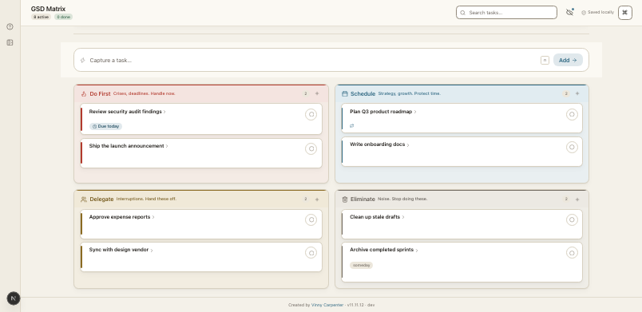

# GSD Task Manager

A privacy-first Eisenhower matrix for deciding what to do, schedule, delegate,
or eliminate.

**Live app:** [gsd.vinny.dev](https://gsd.vinny.dev)
**Current version:** 14.8.7
**Current product:** the single-matrix shell introduced in v9 (ADR 0011),
offline-first local storage, optional PocketBase sync, and the GSD MCP server.

[](https://www.npmjs.com/package/gsd-mcp-server)
[](https://www.npmjs.com/package/gsd-mcp-server)
[](LICENSE)



## What ships

- A responsive four-quadrant matrix with drag-and-drop movement.
- The Add a task bar, full task editing, search, keyboard navigation, and
  optional built-in Smart Views.
- A bookmarklet from Settings that captures any web page for review in GSD.
  Installed on Android, GSD also appears in the share sheet.
- Due dates, tags, dependency selection, and circular-dependency prevention.
- Archive, dashboard/review analytics, sync history, settings, and onboarding.
- Trash with 30-day retention, the Today strip for your top three tasks, the
  weekly sweep of tasks that need a decision, snooze, and What's New notes.
- Local IndexedDB persistence, JSON import/export, offline PWA support, and
  an update notice. A new version installs and takes control on its own; the
  notice offers a refresh.
- Optional multi-device PocketBase sync with Google, Apple, or GitHub OAuth and
  realtime server-sent events.
- A separately installed MCP server with 20 task, analytics, and diagnostic
  tools, including validated and dry-run-aware writes.
- Light and dark Inkwell "GSD Editorial" themes with WCAG AA as the
  accessibility floor.

Retired v7/v8 surfaces such as selection-mode batch operations, the Quick
Settings panel, and smart-view pinning shortcuts are not part of the
single-matrix shell.

## Privacy and data custody

Local-only mode is the default. Tasks are stored in the browser's IndexedDB and
the core product does not require a backend. Clearing browser data can erase
local tasks, so export backups regularly.

Cloud sync is explicitly optional. When enabled, task data is sent to the
configured PocketBase server; the hosted configuration uses
`https://api.vinny.io`. Self-hosting instructions and the encryption-at-rest
hooks live under [`docker/`](docker/). See [`SECURITY.md`](SECURITY.md) for the
precise trust and token-storage posture.

## Using the matrix

The Eisenhower matrix classifies work by urgency and importance:

- **Do First** — urgent and important.
- **Schedule** — important, not urgent.
- **Delegate** — urgent, not important.
- **Eliminate** — neither urgent nor important.

Use the Add a task bar or press `n` to start a task. Use `Shift+N` for the
full composer, `/` for search, `?` for help, and `Option+1` through `Option+4`
(`Alt` on non-Mac keyboards) to focus a quadrant. The in-app help drawer is the
canonical shortcut ledger.

## Saved items

Choose **Move to Saved** on an incomplete task to keep reading material or an idea
outside the matrix. Saved preserves the title, links, tags, and task context.
Use **Notes and links** for short annotations (600 characters including links),
find saved items with the Saved page's search field or the command palette, and
choose **Return to matrix** when ready.
Review the quadrant and due date before returning. Saved items do not contribute
to active task counts, review analytics, reminders, or due badges.

Saved works offline and travels in JSON backups. Saved also works in the native
iPhone, iPad, and Mac app (a separate repository). With cloud sync on, saved
items sync between the web app and the native app. Very old iOS builds show saved items as
ordinary tasks. See [`tasks/saved-tasks/spec.md`](tasks/saved-tasks/spec.md) for
the compatibility scope.

## Local development

Requirements: [Bun](https://bun.sh/) 1.3.14, [Node.js](https://nodejs.org/) 22.22.2+ (or 24.15+ or 26+), and a current browser. `bun run` executes package scripts on Node, so tests, lint, and builds run on your installed Node.

```bash
bun install
bun dev
```

Open `http://localhost:3000`. A fresh browser profile starts at `/about`; use
the **Open App** call to action to enter the matrix. PocketBase is not required
for local task CRUD.

### Canonical checks

```bash
bun run test
bun run test -- --coverage
bun typecheck
bun run typecheck:tests
bun lint
bun run quality:shape
bun run knip
bun run license:check
bun audit --audit-level=high
bun run build
bun run quality:bundle
bun run test:e2e
```

Use `bun run test`, not `bun test`; the latter starts Bun's built-in runner
instead of Vitest, and a guard script stops it. Playwright covers Chromium,
Firefox, and WebKit. The optional authenticated PocketBase harness runs with:

```bash
bun run test:system:pocketbase
```

The harness downloads PocketBase and runs the system tests under
`packages/mcp-server/src/__tests__/system/` against a disposable instance. One
test starts the web app in Chromium and drives its sync push, pull, and realtime
paths, so it needs Playwright's Chromium. That test starts the app with
`bun run dev:e2e`, which deletes `.next` first. The harness also needs `curl`,
`unzip`, `python3`, and network access to GitHub for the PocketBase download. It
supports Linux and macOS on x86_64 and arm64.

To run the CI browser suite locally under the production CSP:

```bash
bun run build:e2e
bun run test:csp
bun run test:pwa
bun run test:e2e:export -- --workers=2
```

`build:e2e` selects the CSP-approved hosted backend at build time. Tests for the
in-app feedback form intercept its requests and never submit them. A plain local build
served on localhost defaults to `http://127.0.0.1:8090`, which the production
CSP intentionally blocks.
On macOS, Firefox tests use a disposable app-data home to avoid Playwright's
Firefox 157 profile-launch issue. It is removed after the browser exits;
the regular browser profile and system privacy permissions are untouched.

## Architecture

- Next.js 16 App Router static export; the application is client-side.
- React 19, TypeScript, Tailwind CSS, and the Inkwell "GSD Editorial" tokens.
- Dexie/IndexedDB for local data and PocketBase for optional cloud sync.
- Vitest for unit/integration coverage and Playwright for browser coverage.
- Bun workspaces, including [`packages/mcp-server/`](packages/mcp-server/).

Start with [`ARCHITECTURE.md`](ARCHITECTURE.md),
[`docs/security-trust-boundaries.md`](docs/security-trust-boundaries.md), and
the architecture decisions in [`docs/adr/`](docs/adr/).

## Deployment

- `bun run build` creates the static export in `out/`.
- Production (gsd.vinny.dev) is the only deploy target; the development deploy
  was retired on 2026-09-11. A release ships when a `v*.*.*` tag starts the
  `deploy-production-release` workflow, which waits for the Gate 2 approval in
  [`docs/ops/gate2.md`](docs/ops/gate2.md).
- `bun run deploy` (`scripts/deploy-prod.sh`) builds on your machine and
  uploads with local AWS credentials, which skips that gate.
- [`docker/Dockerfile`](docker/Dockerfile) builds the self-hosted Caddy and
  PocketBase image.
- [`cloudfront/response-headers-policy.json`](cloudfront/response-headers-policy.json)
  and the related scripts manage production response headers.

Uploading an artifact is not proof that the CDN or a running container serves
it. Verify the deployed URL separately.

## Release documentation checklist

Before changing the release version or announcing a feature:

1. Compare the README version with `package.json`.
2. Verify every feature claim in the current shell, not only in retained data
   models or archived ADRs.
3. Run the canonical checks above. They include the production static build
   (`bun run build`).
4. Update the GitHub release notes, `SECURITY.md`, and the trust-boundary map
   when the release changes their claims.
5. Treat source, tests, build artifacts, deployment, and live runtime as
   separate evidence states.

## Repository blueprint

Each code directory has a `README.md` that states its interface, invariants,
side effects, and check command. This section indexes them. Every entry below
comes from the code or a comment in the named file.

### Local Interface & Invariants

- `next.config.ts` sets `output: "export"`, `trailingSlash: true`, typed routes,
  and the React compiler. Its `buildDate` fallback must not read the clock. A
  static export can't set security headers, so the CDN or the Docker proxy sets
  them.
- `vitest.config.ts` runs tests in jsdom with `TZ=UTC`. It leaves out
  `tests/e2e/**` and `packages/mcp-server/**`. Coverage thresholds are 80%
  statements, 80% lines, 80% functions, and 75% branches.
- `vitest.setup.ts` replaces `localStorage` and `sessionStorage` with an
  in-memory store and loads `fake-indexeddb/auto`.
- `playwright.config.ts` starts the dev server on port 3000.
  `playwright.export.config.ts` serves the built `out/` on `127.0.0.1:3100` and
  never reuses a running server.
- `cloudfront-function-url-rewrite.cjs` appends `/index.html` to extensionless
  paths. It passes `/api` and `/_` through and rewrites a path with a `..`
  segment to `/index.html`. It does the same for a path that holds a CR, LF, or
  NUL character. When the request carries `Accept: text/markdown`, it rewrites
  a route's `index.html` to `index.md`.
- `cloudfront-function-response-headers.cjs` adds the `Link` header to HTML and
  Markdown responses. On the same responses it appends `Accept` to the `Vary`
  header. It sets the content type of every `.md` path to
  `text/markdown; charset=utf-8`. Security headers come from the response
  headers policy.
- `eslint.config.mjs` pins `settings.react.version`. Keep it equal to the
  `react` version in `package.json`.

### Subdirectories & System Boundaries

- app: [app/README.md](./app/README.md). App Router pages and the root layout.
  Most pages mount one component.
- components: [components/README.md](./components/README.md). The React UI:
  matrix, task card, settings, sync dialogs, dashboard, and shared primitives.
- lib: [lib/README.md](./lib/README.md). The task model, Zod schemas, the Dexie
  database, archive and Trash, and the optional sync layer in
  [lib/sync/README.md](./lib/sync/README.md).
- packages: [packages/README.md](./packages/README.md). The `gsd-mcp-server`
  npm package.
- config: [config/README.md](./config/README.md). The one definition of the
  production Content-Security-Policy.
- scripts: [scripts/README.md](./scripts/README.md). Build, deploy,
  quality-gate, and PocketBase setup scripts. Several change production.
- docker: [docker/README.md](./docker/README.md). The self-hosted image:
  PocketBase hooks and migrations behind Caddy.
- tools: [tools/README.md](./tools/README.md). The Stagehand browser
  verification harness.
- docs: [docs/README.md](./docs/README.md). Diagram generators and TLA+ models.
- public: no README, because the build copies every file in `public/` to the
  live site. `sw.js` is the service worker. `sw-cache-logic.js` is generated
  from `lib/sw-cache-logic.ts`, so edit the source. `theme-init.js` sets the
  theme before first paint.
- tests: test code only, so it has no contract README.

### Global Invariants

- IndexedDB is the source of truth. `lib/db.ts:getDb` opens the
  `GsdTaskManager` database, and `lib/db-migrations.ts` registers versions 1 to
  17.
- A task id lives in exactly one of `tasks`, `archivedTasks`, and
  `deletedTasks`. Each move runs in one Dexie transaction (`lib/archive.ts`,
  `lib/trash.ts`, `lib/tasks/crud/delete.ts`).
- A task write and its sync queue row commit together.
  `lib/tasks/crud/helpers.ts:runTaskSyncTransaction` opens one transaction over
  `tasks`, `deletedTasks`, `syncQueue`, and `syncMetadata`.
- Sync resolves conflicts by last write wins on `client_updated_at`
  (`lib/sync/pb-pull.ts:acceptsRemoteVersion`).
- Field limits come from `lib/constants/schema.ts:SCHEMA_LIMITS`. The MCP server
  keeps its own object in `packages/mcp-server/src/constants.ts:SCHEMA_LIMITS`.
  It has 10 keys. Eight match the web values, and `ID_MAX_LENGTH` and
  `MAX_BULK_TASKS` exist only there.
- The production Content-Security-Policy has one definition,
  `config/csp.cjs:buildCsp`. A test fails when the CloudFront or Caddy copy
  drifts.
- `public/sw.js` keeps its `CACHE_VERSION` placeholder in git. The build stamps
  the real version into `out/sw.js`.
- Stored sync errors carry no task text.
  `lib/sync/error-categorizer.ts:sanitizeSyncError` returns a fixed code.
- `lib/logger.ts:sanitizeMetadata` masks log metadata keys named `title`,
  `description`, `tags`, `subtasks`, or `notes`, and keys that match its secret
  pattern. It recurses into nested objects through `sanitizeValue`. The log
  message and `errorMessage` get token masking only.

### Global Side Effects

- Browser storage: IndexedDB, `localStorage`, `sessionStorage`, and Cache
  Storage under `gsd-*` cache names.
- Network, during sign-in, before sync is on: `listAuthMethods` on the
  PocketBase `users` collection, sent when the user reaches for a sign-in
  button. The provider returns through the `/api/gsd/oauth-callback` route.
- Network, with sync on: the PocketBase `tasks` and `users` collections,
  the `/api/gsd/account` and `/api/gsd/sessions` routes, and one realtime
  subscription.
- Network, only when the user sends feedback: one `POST` to the PocketBase
  `feedback` collection, with no credentials.
- `scripts/deploy-app.sh` syncs `out/` to S3 with `--delete` and invalidates the
  CloudFront distribution.
- `scripts/deploy-cloudfront-function.sh` creates or updates two CloudFront
  functions and publishes them. It then updates the distribution's function
  associations and invalidates the distribution.
- `scripts/deploy-cloudfront-response-headers-policy.sh` creates or updates
  the CloudFront response headers policy.
- `scripts/fix-discovery-content-types.sh` rewrites the content type and cache
  metadata of the discovery files in the S3 bucket.
- `scripts/setup-labels.sh` creates or overwrites ten labels on the GitHub repo
  of the current directory.
- `scripts/setup-pocketbase-feedback-collection.sh` also patches server-wide
  PocketBase settings: rate limits and request log settings.
- The PocketBase setup scripts in `scripts/` create or patch collections on the
  server named by `PB_URL`, which defaults to production.

### System Verification

- Run: `bun run test`
- Run: `bun typecheck`, `bun run typecheck:tests`, `bun lint`,
  `bun run quality:shape`, and `bun run knip`
- Run: `bun run build:e2e`, then `bun run test:e2e:export` for the browser suite

## Contributing and security

Read [`CONTRIBUTING.md`](CONTRIBUTING.md) before making changes. Report
vulnerabilities through the private process in [`SECURITY.md`](SECURITY.md),
not a public issue.

## License

[MIT](LICENSE)
