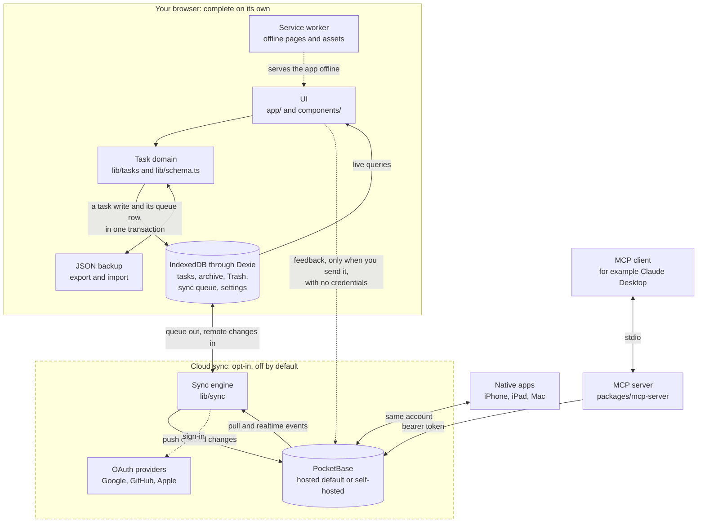

# GSD Task Manager: system overview

GSD Task Manager is a single-user Eisenhower matrix. Each task has an `urgent` flag and an `important` flag, and those two flags place it in one of four quadrants.

The app is local-first. IndexedDB in your browser is the source of truth, and the app works in full with no account and no network. Cloud sync is opt-in and off by default. The MCP server reads and writes through the sync backend, so it needs sync turned on.

This page is one diagram of the parts and the boundaries between them. It holds no field lists, function signatures, or tool names, because those live in the code and drift when copied. For those, follow the links:

- Product intent: [`PRODUCT.md`](../PRODUCT.md)
- Map of the maintained sources: [`ARCHITECTURE.md`](../ARCHITECTURE.md)
- Decisions and the options each one rejected: [`docs/adr/`](./adr/)
- Risks, trust boundaries, and what the server can read: [`SECURITY.md`](../SECURITY.md) and [`security-trust-boundaries.md`](./security-trust-boundaries.md)
- Contracts for each code directory: [`lib/README.md`](../lib/README.md), [`lib/sync/README.md`](../lib/sync/README.md), and [`packages/mcp-server/README.md`](../packages/mcp-server/README.md)

## Parts and boundaries

## How to read it

- The solid box is the whole app. Everything inside "Your browser" runs with no account. The dashed box is optional, and nothing crosses into it until you sign in.
- A task write and its sync queue row commit together. `lib/tasks/crud/helpers.ts:runTaskSyncTransaction` opens one transaction for both. With sync off it queues nothing.
- Each task lives in one place. A task id is in exactly one of the live tasks, the archive, or Trash. See [ADR 0013](./adr/0013-archived-tasks-conditional-tombstone.md) and [ADR 0015](./adr/0015-trash-with-retention.md).
- Sync is last write wins. The newer `client_updated_at` wins, and the losing copy is not kept. See [ADR 0003](./adr/0003-last-write-wins-conflict-resolution.md).
- A sync belongs to one account. Every local sync write checks that the device is still signed in as the account the sync started for. See [`lib/sync/README.md`](../lib/sync/README.md) and the model in [`docs/formal/sync-session/`](./formal/sync-session/).
- The server stores what it is sent. The hosted service keeps task content as plain text. The self-hosted image encrypts five fields at rest. See [ADR 0016](./adr/0016-hosted-sync-defers-field-encryption.md).
- The MCP server never touches the browser. It talks to PocketBase with a token you give it, so it sees only what sync has uploaded. See [ADR 0005](./adr/0005-mcp-server-integration.md).
- Offline means full function, minus sync. The service worker serves the app from its caches. See [ADR 0012](./adr/0012-sw-multi-cache-strategy.md).

GitHub renders the diagram. So does VS Code with a Mermaid extension.
